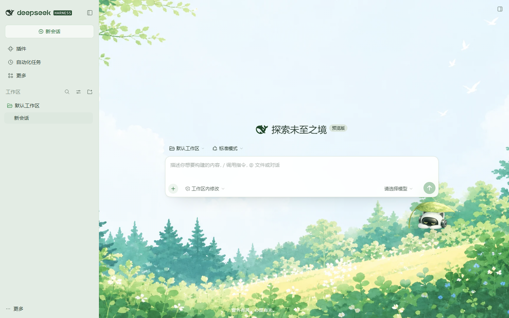

# WorkBuddy 有风 · DSH 主题

把 WorkBuddy 5.9.3 的「有风」外观包移植到 DeepSeek Harness Web GUI。



## 主题内容

- 主色：森林绿 `#3c8c4e`（深绿 `#256d37` / `#21472b`）
- 页面底色：`#f6f8f5`，卡片 `#ffffff`，侧栏 `#e3ece4`
- 正文：`#12261a`，分隔线：`#dce7dd`
- 首页背景：WorkBuddy `workbuddy-skin-green` 的 `green.png`（已压缩为 WebP）
- 右下角：`treecat.png` 叶猫伙伴
- 首页底部署名：`窗外有风，心里有光。`
- 覆盖范围：侧栏、对话、输入框、设置面板、按钮、代码块、滚动条及 DSH `--dsw-*` token

## 安装

### 方式一：DSH 插件页安装（推荐）

在 [Releases](../../releases) 下载 `dsh-client-ui-skin-workbuddy-youfeng-0.1.0.tgz`，然后：

**DSH Desktop → 插件 → 添加插件 → 安装第三方插件 → 粘贴 tgz 绝对路径 → 安装 → 立即启用**

### 方式二：npm

发布后可直接在插件页输入：

```
dsh-client-ui-skin-workbuddy-youfeng
```

## 从源码构建

```powershell
npm run build
```

构建脚本会把 `src/theme.css`、`src/tokens.json`、`assets/*.webp` 内联进 `lib/client.js`。

## 目录

- `src/theme.css` — 主题样式（背景层、侧栏、对话、输入框、滚动条）
- `src/tokens.json` — DSH `--dsw-*` token 覆盖表（浅/深两套值）
- `src/client.template.js` — 浏览器端插件模板
- `scripts/build-theme.cjs` — 生成 `lib/client.js`
- `lib/client.js` — 实际被 DSH 加载的浏览器 bundle
- `assets/` — 压缩后的背景与叶猫素材
- `preview/light.png` — 主题预览图
- `market/` — DSH 插件市场索引与皮肤市场收录模板

## 停用 / 卸载

在 DSH 插件页找到 `dsh-client-ui-skin-workbuddy-youfeng`，关闭并移除即可。

## 素材说明

主题配色与图片来自本机 WorkBuddy 5.9.3 的外观资源：
`%USERPROFILE%\.workbuddy\appearance-resources\theme-tkbera-1789703092000\workbuddy-skin-green`

图片素材版权归原权利方所有，本仓库仅用于个人外观定制；公开发布或商业使用前请先确认授权或替换素材。详见 [NOTICE](NOTICE)。
